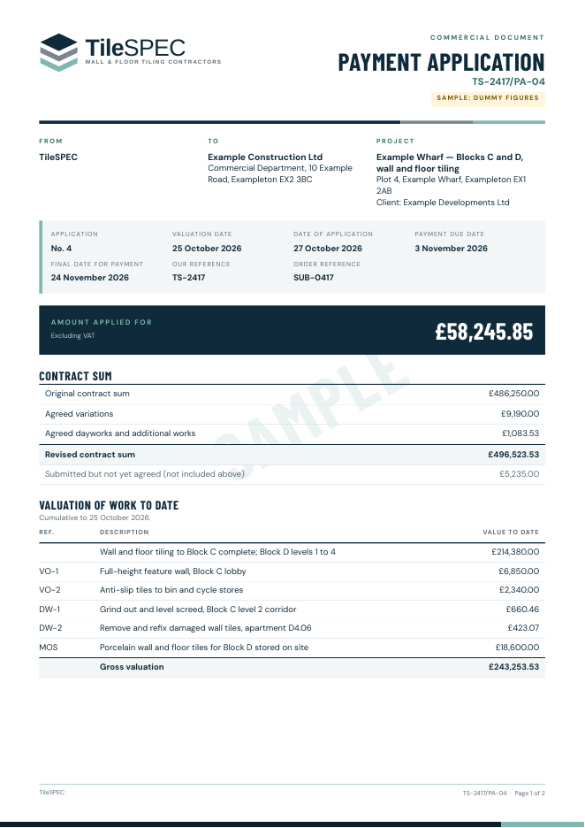
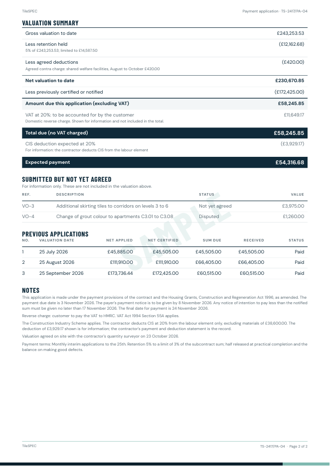

# Sample commercial documents

These PDFs were produced by running a **fictitious job** through the real database functions
(`scripts/sample-commercial-documents.sql`) and printing the snapshots each issued document stored. Every name is invented
and every figure is dummy. Regenerate them with `npm run samples:documents`.

TileSPEC's business details are entered by the owner and none are confirmed yet, so the samples print only the trading name
"TileSPEC": no registered office, company number, VAT number or bank details. The scenario records a placeholder VAT
registration only so the database can show the reverse charge and CIS working; the generator removes it before printing.

| File | What it shows |
|---|---|
| [payment-application.pdf](payment-application.pdf) | Interim application No. 4 on a £486,250 subcontract: agreed variations and dayworks, materials on site, 5% retention limited to 3% of the contract sum, an agreed contra charge, the previous certificates, the domestic reverse charge, CIS on the labour element, the Construction Act dates, and the variations not yet agreed shown for information only |
| [invoice.pdf](invoice.pdf) | The invoice for certified application No. 3, under the reverse charge |
| [credit-note.pdf](credit-note.pdf) | A part credit of that invoice |
| [variation-schedule.pdf](variation-schedule.pdf) | Every variation with its status (approved, not yet agreed, disputed), client instruction, value and the application it was claimed in |
| [daywork-summary.pdf](daywork-summary.pdf) | Each daywork's labour, plant and materials at the agreed rates and markups, with site acknowledgement, commercial approval and client authorisation kept separate, and a daywork included in a variation |
| [statement.pdf](statement.pdf) | The statement of account: sums due, invoices, credit notes, payments with CIS, running balance and ageing |
| [final-account.pdf](final-account.pdf) | A small job paid on completion: the final account with standard-rated VAT |
| [final-account-invoice.pdf](final-account-invoice.pdf) | Its VAT invoice |

