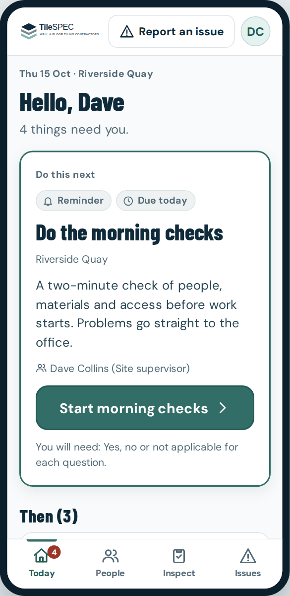
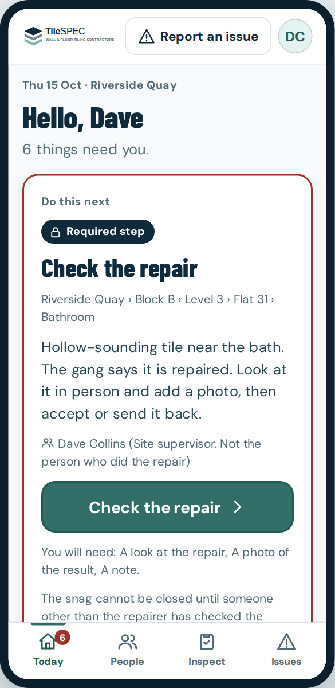
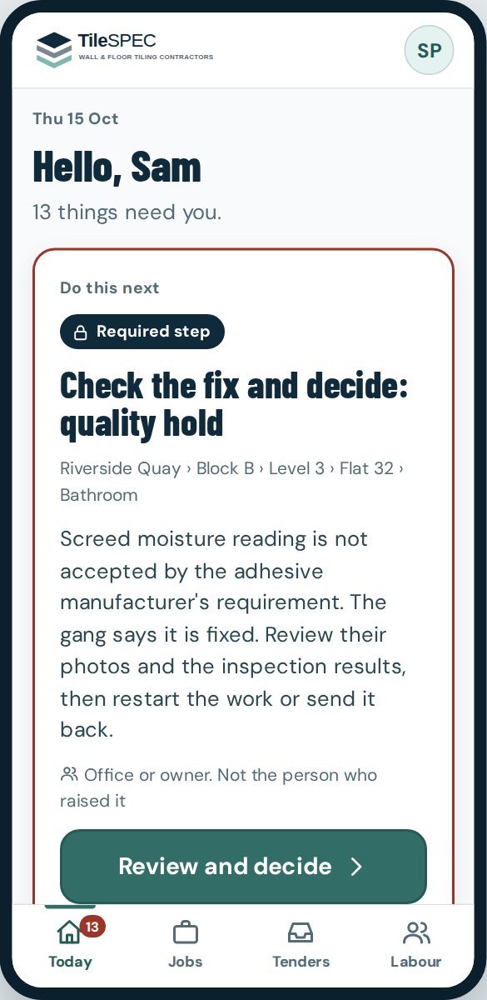
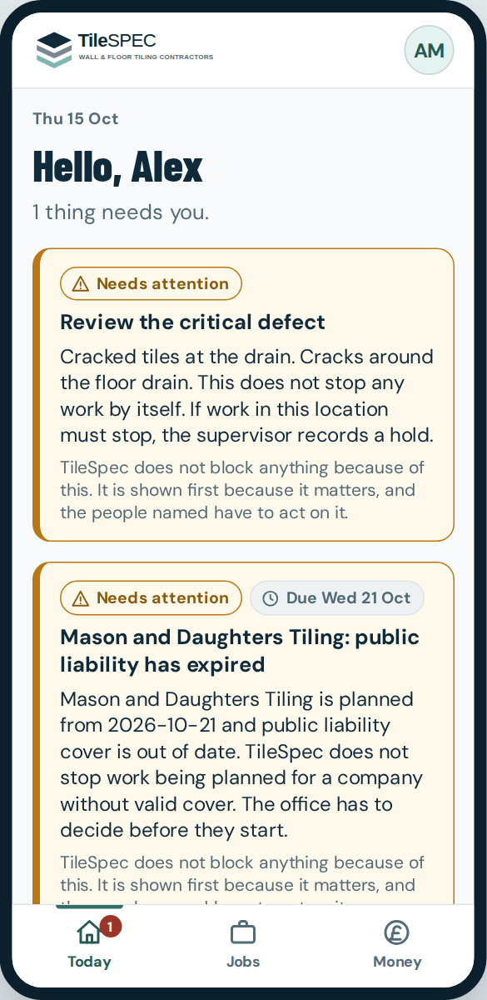
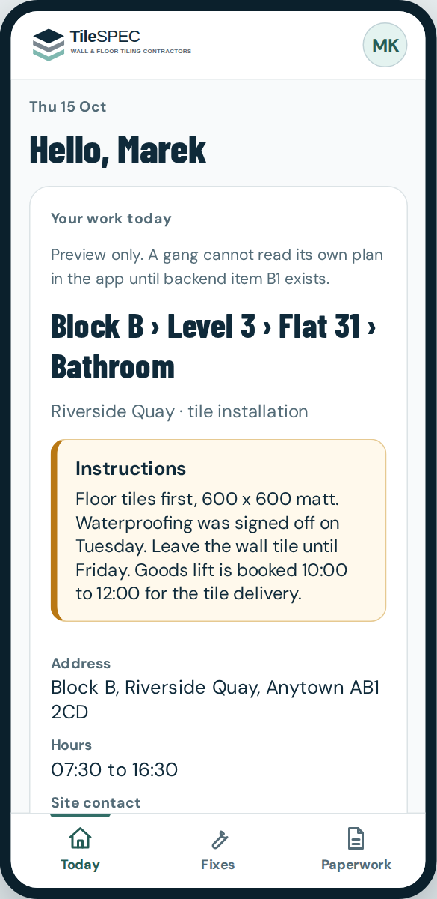

# 2. Proposed navigation

## 2.1 Rules

1. At most four destinations per role (owner and subcontractor have three). Never a menu behind a menu.
2. The same destinations are always on screen: a bottom bar on a phone, a left rail on a desktop. See the two layouts side by side in the prototype (`Phone` and `Desktop` toggle).
3. Every screen except the four destinations has a visible "Back" that names where it goes ("Today", "Jobs").
4. **Today** is always first. It answers one question: what should I do next.
5. Everything about a job lives inside the job. People do not choose between "Site dashboards", "Snag register" and "Holds and releases".
6. **Report an issue** is in the supervisor's header on every site screen. It is the everyday action. There is no prominent Stop Work button. Stopping work is one of three choices inside the report (see 2.7) and uses the existing safety and quality hold mechanisms, permissions and audit history unchanged.
7. A destination exists only if it holds something the role does repeatedly. Everything else is reached from Today or from inside a job.

## 2.2 The four roles

Changed after review: the owner has **no Risks destination** (risks and exceptions sit under Today; Money stays separate) and the subcontractor has exactly **Today, Fixes and Paperwork**.

| | Owner | Office | Supervisor | Subcontractor |
| --- | --- | --- | --- | --- |
| Database role | `owner` | `contracts_manager` (money only if `financial_access`) | `supervisor` | `lead_installer`, `subcontract_installer` |
| Job | Decisions, approvals, profit, risk, exceptions | Tenders, job set-up, labour, documents, chasing | Today's site, people, inspections, snags, handover | Today's work, paperwork, fixes |
| Destination 1 | **Today** decisions waiting | **Today** | **Today** | **Today** your work |
| Destination 2 | **Jobs** | **Jobs** | **People** who is on site | **Fixes** |
| Destination 3 | **Money** | **Tenders** | **Inspect** | **Paperwork** |
| Destination 4 | (three is enough) | **Labour** | **Issues** snags and stopped work | (three is enough) |
| Always visible | | | Report an issue | |

The owner and subcontractor have three destinations because nothing else is theirs. Fewer is better. "Everything else" in the real app's menu keeps the whole original menu reachable, so nothing is lost while the new shell is behind a flag.

## 2.3 What each destination holds

| Role | Destination | Holds | Replaces or wraps today |
| --- | --- | --- | --- |
| Owner | Today | Decisions only you can take, then **Risks and exceptions** (stopped work, critical or failed items, cover problems), then what is being watched | Overview, Holds and releases, Quality control, Site alerts, Snag register |
| Owner | Jobs | All jobs, status, stopped work count. Job page has plan, locations, documents, changes, money | Contracts |
| Owner | Money | Budget against target profit per job, read-only. Says plainly what is not recorded. No buttons | Overview metrics, Estimator link |
| Office | Today | One next action, then the rest, waiting-on-others, saved today | Overview, Site alerts |
| Office | Jobs | Jobs, with set-up steps, plan, locations, documents, changes, money (if allowed) | Contracts, plan, locations, actual |
| Office | Tenders | Enquiries by deadline, open and read. Read-only until tender status can be recorded (B5) | Tenders |
| Office | Labour | Who is planned where, companies and cover, people to confirm | Workforce, Team |
| Supervisor | Today | One next action, then **every** other task underneath, then waiting on others. Messages and handover under "More" | Site dashboard |
| Supervisor | People | Planned gangs: Here, Not here, finished. Earlier unfinished work | Workforce |
| Supervisor | Inspect | Inspections needed now, start another, saved | Inspections |
| Supervisor | Issues | Snags and stopped work for the site, with Report an issue | Snag register, Holds and releases |
| Subcontractor | Today | One fix if there is one, then the rest of their queue. Plan details only once B1 exists | (none: new) |
| Subcontractor | Fixes | Anything the gang has been asked to put right | Snag register (filtered) |
| Subcontractor | Paperwork | Drawings and documents for their job. Read-only (no send-a-photo until a record type exists) | Contract page documents |

## 2.4 Old page to new home

No existing page is deleted in the first phases. They remain reachable by their current links while the new screens are switched on behind a flag (see the implementation plan).

| Existing route | New home |
| --- | --- |
| `/admin` | Today (owner, office). Installers go to Today (subcontractor) |
| `/admin/contracts`, `/admin/contracts/[id]` | Jobs |
| `/admin/contracts/new` | Jobs, "New job" |
| `/admin/contracts/[id]/plan`, `/locations`, `/actual` | Inside the job: Plan, Locations, "Planned against actual" |
| `/admin/workforce`, `/admin/team` | Labour (workforce), account menu (user access) |
| `/admin/tenders` | Tenders |
| `/admin/estimator` | Tenders and Jobs, "Start an estimate" |
| `/admin/quality`, `/admin/alerts` | Today (derived from the same records). Owner: Risks and exceptions section |
| `/admin/snags`, `/admin/holds` | Issues (supervisor), Today (owner, office) |
| `/admin/supervisor`, `/admin/supervisor/sites/[id]` | Today (supervisor) |
| `.../workforce` | People |
| `.../inspections`, `/admin/supervisor/inspections` | Inspect |
| `.../snags`, `/admin/snags/new` | Issues, via Report an issue |
| `/admin/holds/new` | Report an issue, "Does work need to stop here?" (the existing hold form, opened with the type chosen) |
| `.../messages` | Today, "More", "Messages from the office" |
| `.../finish` | Today, "More", "End of day handover" |
| `.../commercial` (variations, dayworks) | Not linked from the new Today. Returns only when B4 exists |
| `.../history`, `.../tasks/[taskId]` | Kept as detail pages |

## 2.5 Screens that are unnecessary today

| Screen | Why it is unnecessary | Disposition |
| --- | --- | --- |
| Variations and Dayworks tiles | Lead to a page saying the feature is not built | Not shown on the new Today until B4 exists |
| Office mobile menu (`
`) | Four destinations fit the bottom bar | Replace |
| Contract overview warnings list | Static, no owner, no date | Replaced by set-up actions in Today and in the job |
| Separate "Site alerts" | A morning check problem is an action for someone | Becomes actions in Today |
| Separate "Quality control" | Same records as Issues and Today | Becomes part of Today (owner: Risks and exceptions) |

## 2.6 Plain English

The prototype uses one vocabulary everywhere. The full table is in section 1.3 of the audit. The rules:

- Say what the person does: "Check the repair", not "Re-inspection".
- Say what will happen: "Restart work here", not "Release".
- Use the site's words: "snag", "stop work", "gang".
- No codes on screen. Rule numbers (G05, R01) appear only in the review notes.

## 2.7 Report an issue (replaces the Stop Work button)

One sheet, plain English, three outcomes:

1. **Does work need to stop here?** No (default), "Yes: quality hold", or "Yes: safety stop".
2. If **No**, how serious: minor, major or critical. The sheet says "A critical defect goes to the office. It does not stop work by itself."
3. If **Yes**, the sheet says only this location and activity stop, and for a safety stop to make the area safe first.

In the real app the page `/admin/supervisor/sites/[id]/report` offers three links to the **existing** forms: new snag, new quality hold, new safety stop. No new record types, no new permissions. Holds are released exactly as before: by someone independent, with no critical defect open, with the audit trail unchanged.

## 2.8 The three-second test, per role

Each role's first screen has one answer in the largest type, one button, and the reason in one sentence.

| Role | Screen | The answer |
| --- | --- | --- |
| Supervisor, quiet morning |  | "Do the morning checks" |
| Supervisor, busy day |  | "Check the repair" |
| Office |  | "Check the fix and decide" |
| Owner |  | A decision, or "You are up to date". Risks and exceptions below |
| Subcontractor |  | Where to be and what to do |

How to run the test with real people is in the acceptance tests.
