# 3. Screen by screen

The clickable prototype is `docs/redesign/prototype/index.html`. Open it in a browser (no server needed). The bar at the top is for reviewers only:

| Control | Use it to |
| --- | --- |
| Signed in as | Switch person: Alex (owner), Sam (office, money), Jo (office, no money), Dave and Ellie (supervisors), Marek (subcontractor) |
| Screen | Phone frame or desktop frame. The same screens, same four destinations, rail instead of bottom bar |
| Day | "Quiet morning" (nothing done yet) or "Busy day" (stop work, snags, inspection request, unfinished work from yesterday) |
| Backend reality check | Labels each part **Built**, **Query only** or **New backend** (B1 to B7) |
| Poor signal | The first save fails, nothing typed is lost, the retry works |
| Reset | Start the scenario again |

**This is the Phase 2 preview.** The rules shown here are the real engine (`lib/operations/next-actions`), bundled into `prototype/engine.js`. Nothing is a separate prototype copy. Open it on a phone or at a narrow window width for the mobile layout. To serve it locally: `npx serve docs/redesign/prototype` (or just open `index.html`), then add `?role=u-dave&device=mobile`.

Saving is simulated in memory. After a save the Next Action rules run again, so what the next person is asked to do really changes. Open the prototype as the supervisor, use Report an issue and choose a safety stop, then switch to Marek, then to Sam.

Phone and desktop screenshots of every screen below are in `docs/redesign/screenshots/` (`<name>-mobile.png`, `<name>-desktop.png`).

## 3.1 How every screen is built

| Pattern | Rule |
| --- | --- |
| Hero card | One next action: the instruction, where, who, why, what you will need, one button. Required steps (gates) have a red border and say exactly what they stop. Alerts have a distinct colour and "Needs attention" with an honest note about what they do not do. Reminders are labelled "Reminder". |
| Then (n) | **Every** other task, never truncated, so nothing is hidden behind a "Show more". The main button is only the first one |
| Waiting on others | Things someone else is doing, with their name. Items you are barred from (independence) appear here with the reason |
| Saved today | Real saved records with a "Saved" chip and a time, so progress is visible without tick-boxes |
| State chips | Always icon plus words: Saved, Waiting, Blocked, Must do, Reminder, Overdue |
| Sheets | Small forms open over the screen and keep what you typed if a save fails |
| Back | Named, always at the top-left of detail screens |
| Targets | 52 to 60 px tall. 17 px body text, 13 px for secondary labels. No hover-only controls |
| Motion | None except a 160 ms sheet slide, removed for reduced motion |

## 3.2 Supervisor

| Screen | Primary action | What is on it | Wraps today | Backend |
| --- | --- | --- | --- | --- |
| **Today** | The hero button | Greeting, Report an issue (header), alert banner, hero, Then (n), Waiting on others, Saved today, Messages and Handover under More | `supervisor/sites/[id]/page.tsx`. With `FEATURE_NEXT_ACTIONS` on it renders `next-actions-today.tsx` from the shared engine | Query only: rules read existing data |
| **Morning checks** | Save morning checks | The 11 existing questions in People, Materials, Site readiness. Yes, No, Not needed. All must be answered | `checks` page, `morning-checks.ts` | Built |
| **People** | Here | One card per planned gang today: Here, Not here (with reason), Finished for the day. Earlier unfinished work first. Add someone not on the plan | `workforce` page, `TeamCardView` and `PeriodView` in `workforce-day.tsx`, `unplanned-form.tsx` | Built |
| **Inspect** | Start inspection | Needed now (mandatory, then office requests), start another, saved results | `inspections` pages | Built |
| **Inspection form** | Save inspection | Checks for the activity, Pass / Fail / Not needed, photo, note (required if anything fails). States clearly that a pass does not release a stop or approve payment | `workmanship-form.tsx` | Built |
| **Issues** | Report an issue | Stopped work and open snags for the site, each with a plain-English state | `snags`, `holds` registers | Built |
| **Snag** | Choose who fixes it, or Repair is good | Detail, then the one form that applies: assign a gang, or re-inspect. If you did the repair you see why you cannot check it | `snags/[id]` | Built |
| **Report an issue** (header button) | Report it | Where, what is wrong, photo, "Does work need to stop here?" No / Yes: quality hold / Yes: safety stop. No: how serious (a critical defect goes to the office and does not stop work by itself). Yes: only that location and activity stop, then straight to "Who fixes it?" | `snags/new`, `holds/new` (existing forms, existing permissions and audit history) | Built |
| **Stopped work detail** | Save (choose the gang) | Why, what must happen, gang, state. Release is shown as the office's decision | `holds/[id]` | Built |
| **Messages** | Got it | Instructions with acknowledgement, QA requests with Start inspection | `messages` | Built |
| **Handover** | Send handover | Summary filled in from today's records, two free-text boxes | `finish` | Built |

Screens:  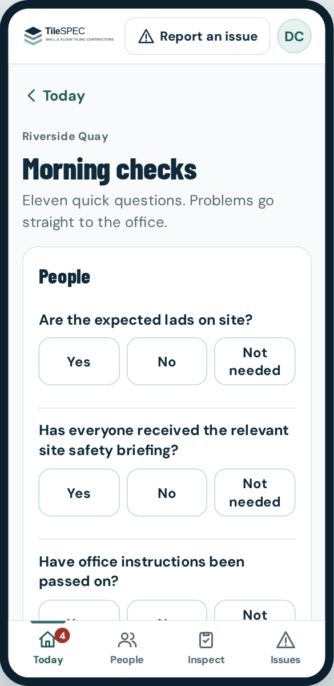 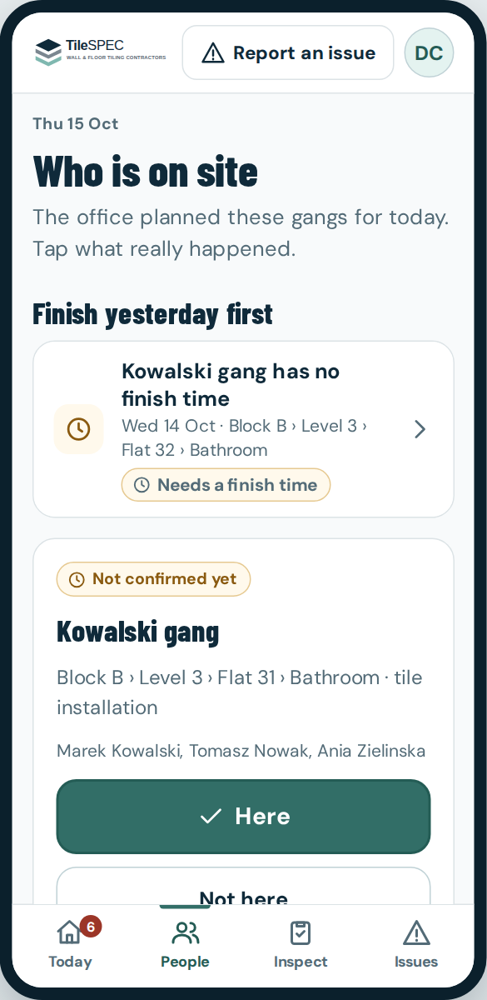 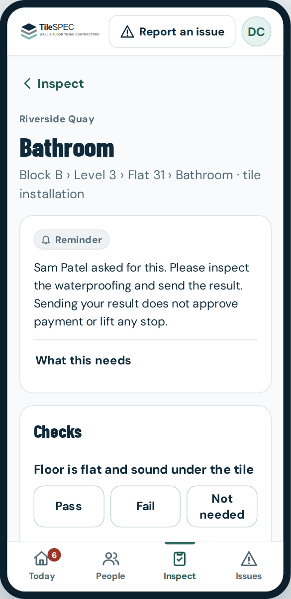 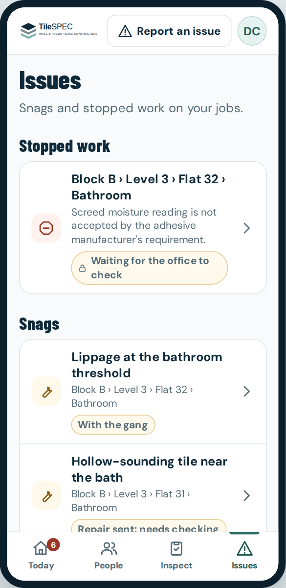 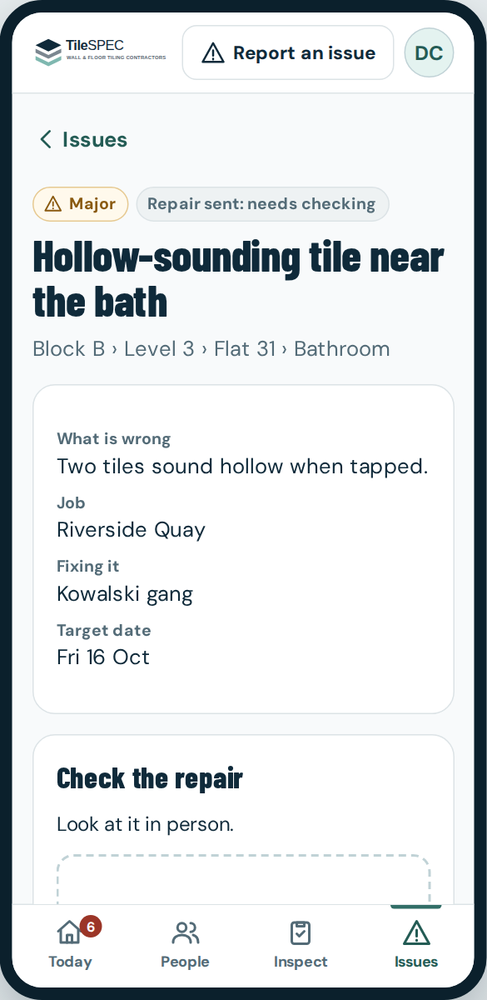 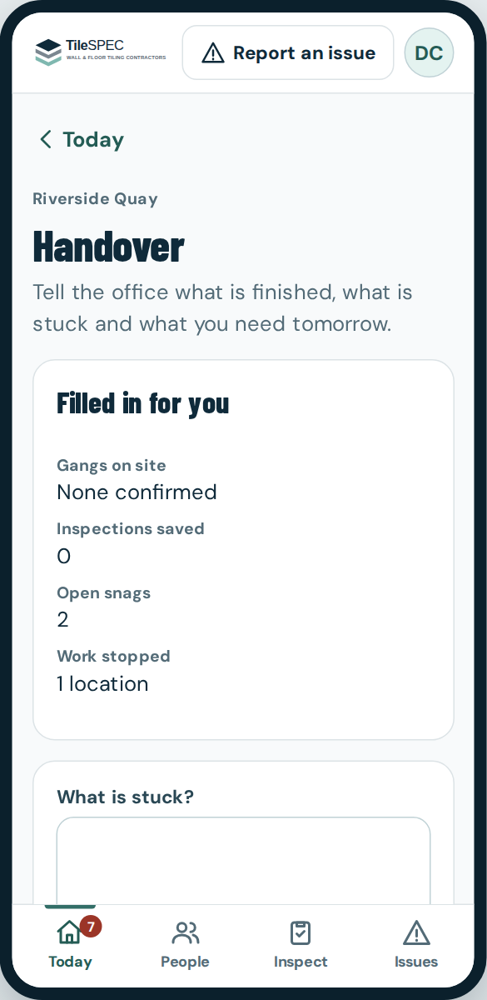

Desktop: 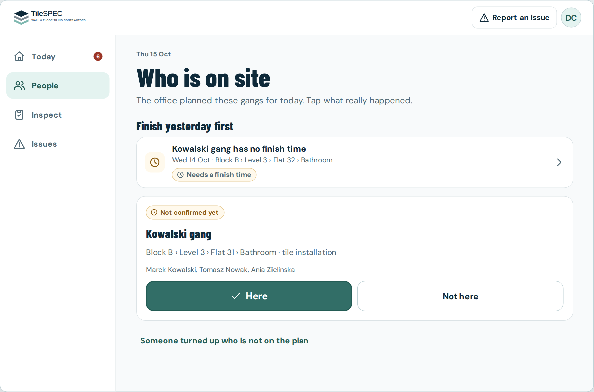

## 3.3 Office

| Screen | Primary action | What is on it | Wraps today | Backend |
| --- | --- | --- | --- | --- |
| **Today** | The hero button | Same pattern. Jobs list with how many things need you per job | Overview, Site alerts | Query only |
| **Jobs** | Open a job | Jobs with "N for you" and "N stopped" | Contracts list | Query only |
| **Job** | The hero button | Header, the next thing for this job, other open items, then sections that open on demand: Plan, Locations, Documents, Money, Recent activity. **No Changes or extra work section** until B4 exists | `contracts/[id]` and its sub-pages | Built |
| **Set-up sheets** | Save | Add locations, give a supervisor, add specification, plan work, publish checks, decide inspection applicability, give package access, save certificate. Each is one small form | `site-setup.tsx`, `plan-form.tsx`, `location-builder.tsx`, `inspections.ts` requirement and template inputs | Built |
| **Decision** (release review) | Restart work here, or Send back | Why it was stopped, what the gang did, inspection results, two "I looked at" ticks, safety: principal contractor name and reference, reason. If you raised or corrected it, or a critical defect is open, there is no button and the reason is the first thing on screen | `holds/[id]` release form | Built, including independence |
| **Tenders** | Open an enquiry | Enquiries by deadline. Read-only | `tenders/page.tsx` | Built |
| **Tender** | Read | Details and documents. No reply, decline or estimate buttons until tender status can be recorded (B5) | same | Documents built |
| **Labour** | Plan work | Planned this week, companies with cover status, people to confirm | `workforce`, `company-list.tsx`, `plan-board.tsx` | Built |

Screens:  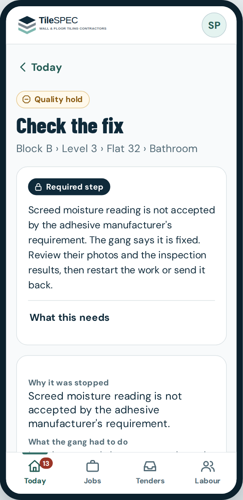 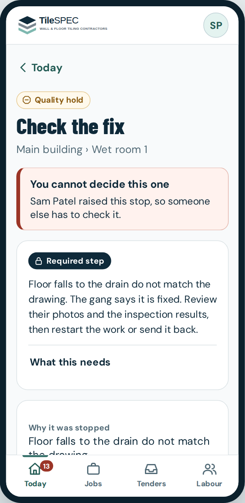 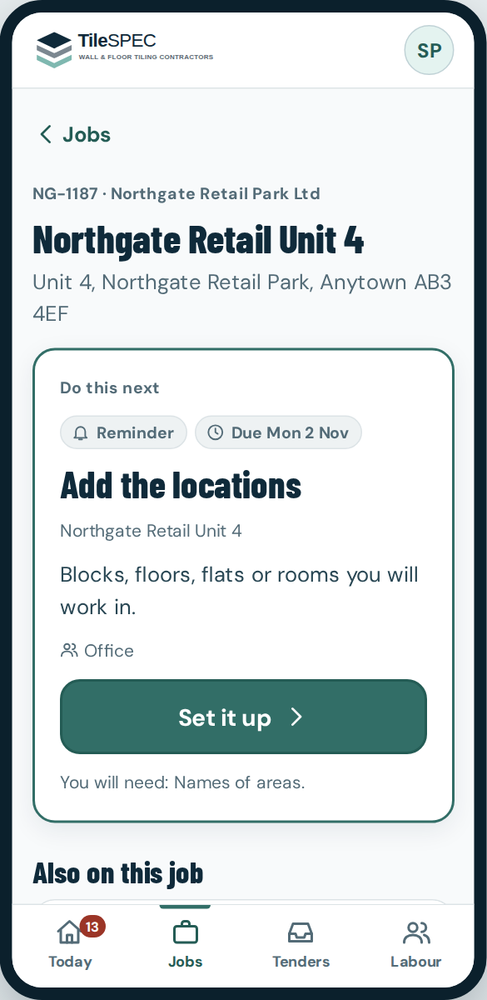 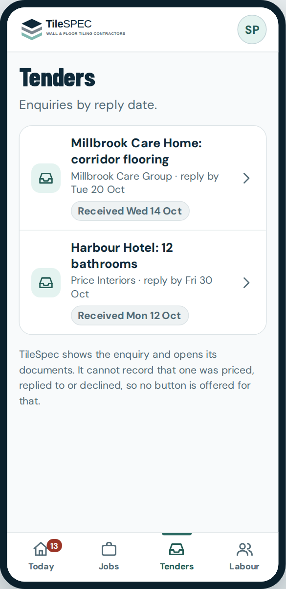 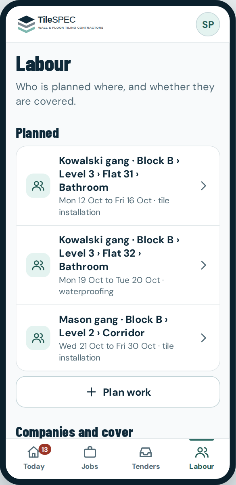

Desktop: 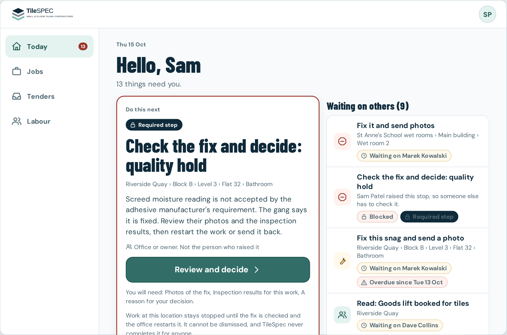 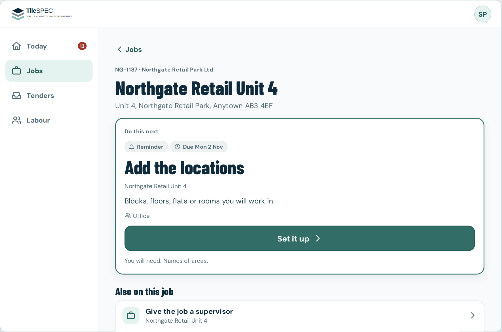

Jo (office without money access) sees the same screens with every figure removed. The smoke test asserts that.

## 3.4 Owner

| Screen | Primary action | What is on it | Backend |
| --- | --- | --- | --- |
| **Today** | The decision, if any | A decision only you can take (release review when you are independent), then **Risks and exceptions (n)**: work stopped, critical or failed items, out of cover, then what is being watched | Query only |
| **Jobs** | Open a job | As office | Query only |
| **Money** | Read | Budgeted cost, profit after reserve, margin against target for each job. A plain box says what is **not** recorded: actual costs, variations, claims, your sign-off on a low margin. There are no buttons for any of those | Query only. Missing parts: B3, B4, B6 |

A low margin is shown as information with the sentence from the existing overview. The prototype does not present a tick-box for owner acceptance because that would imply a record exists (finding R-5).

Screens:  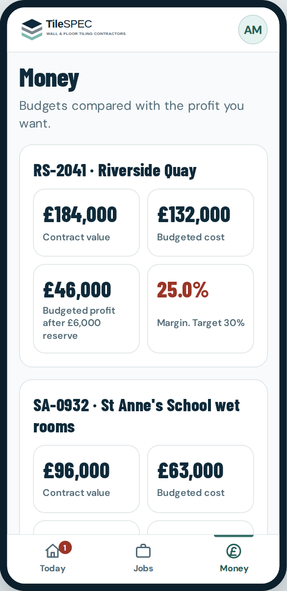

Desktop: 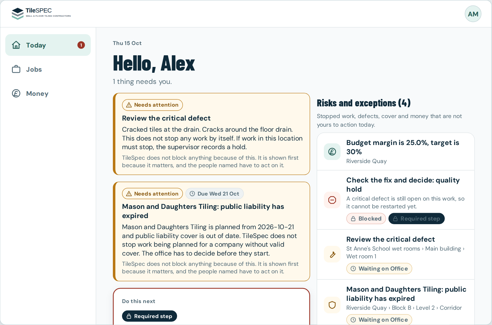

## 3.5 Subcontractor

| Screen | Primary action | What is on it | Backend |
| --- | --- | --- | --- |
| **Today** | Fix it and send photos, if there is a fix | The hero if the gang has something to fix, then Then (n) and Waiting on others. Plan details (address, hours, contact) are **not** shown until B1 exists | Query only for fixes. Plan details need **B1** |
| **Fixes** | Open the fix | Anything the gang has been asked to put right, with state | Built (snags and holds the gang is assigned) |
| **Fix** | Send fix | Photo, date finished, note. Then, for a stop, "Ask the office to check" | Built |
| **Paperwork** | Open | Operational drawings and documents for their location. No prices. No upload | Built (documents), Query only (list for gang) |

The subcontractor has exactly three destinations: Today, Fixes, Paperwork. **"Tell the supervisor" and "Send a progress photo" are not shown** because there is no backend record for them (B2).

Nothing financial, no other gang, no other job appears. The smoke test searches every screen for money words and other companies.

Screens:  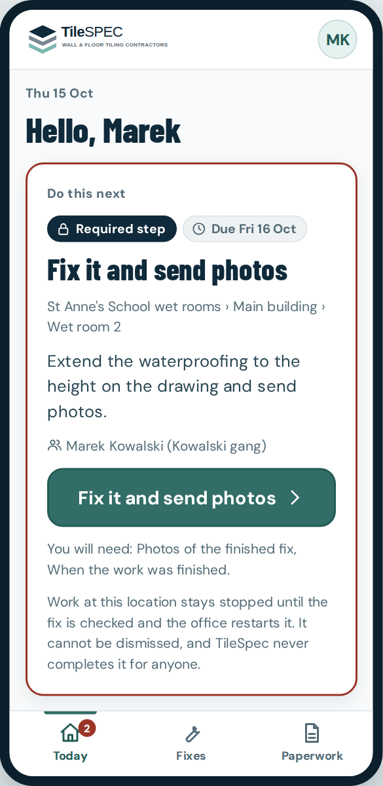 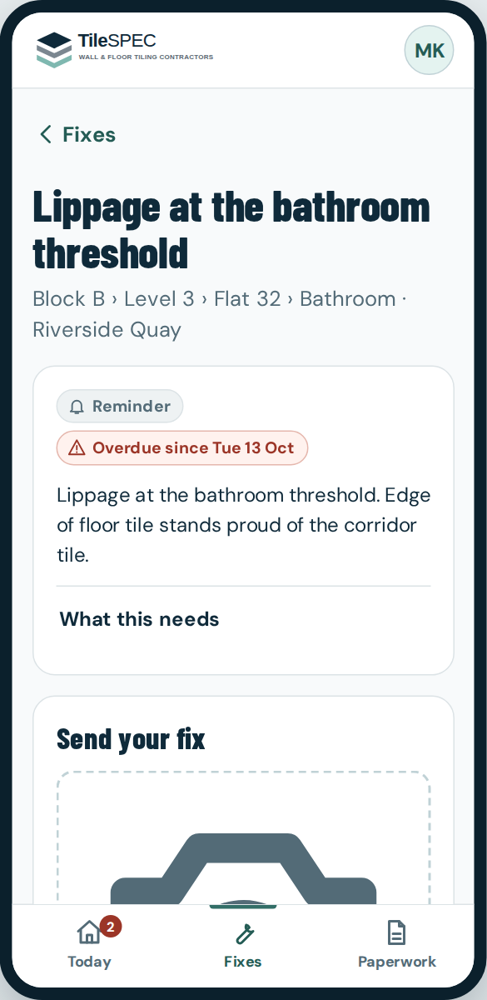 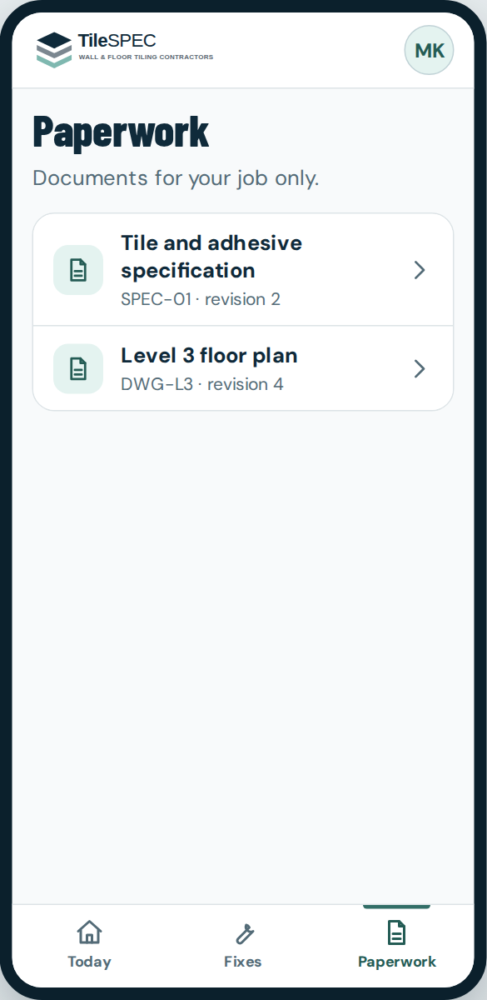

## 3.6 Saved, pending, blocked, completed

| State | Meaning | Shown as |
| --- | --- | --- |
| Pending | A save is in flight | Button says "Saving…" and is disabled |
| Saved | Server confirmed | "Saved: …" message, then a "Saved" row in Saved today |
| Not saved | Save failed | Red message "Nothing you entered was lost", button changes to "Try again". Matches the real `CONNECTION_FAILED` wording |
| Waiting | Someone else must act | "Waiting on <name>" |
| Blocked | You are the right role but may not do this one | Red banner with the reason, no button |
| Completed | The rule no longer fires | It disappears from Today and appears under Saved today |

## 3.7 Other screens

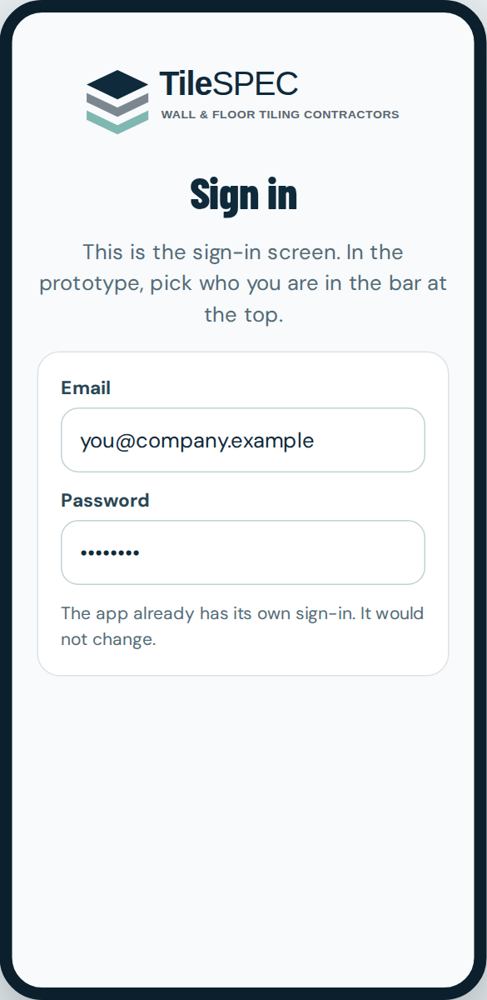 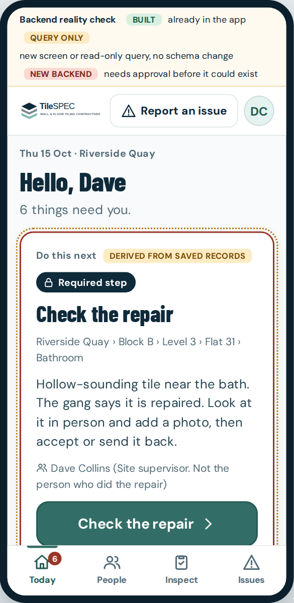

The sign-in screen is unchanged in the real build. The second image shows the reviewer's "Backend reality check" overlay.
