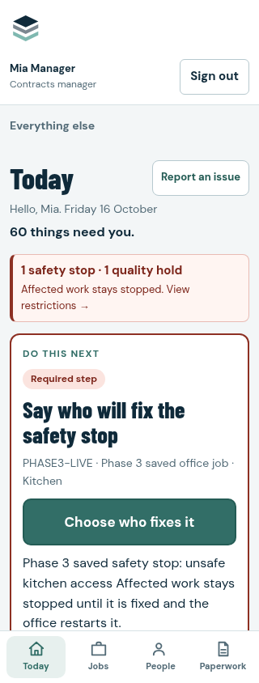
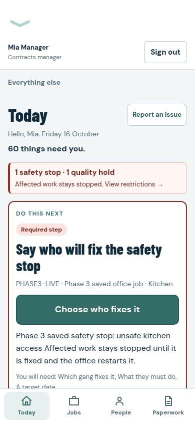
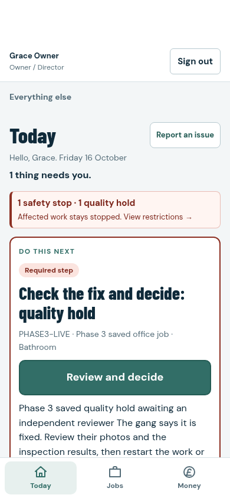

# Office and Owner Today: phone review

These images show the actual authenticated application and live snapshot loader
against disposable local PostgreSQL, after saving test jobs, messages, findings
and restrictions through the existing workflows. They contain no production or
customer data. Auth and Storage transports are fixtures; the business records,
functions and RLS are real.

The first-screen checks require the full next-action title above the fixed
navigation. Ordinary Office and Owner records also keep their primary button
visible without scrolling at 320px and 390px.

| Office, 320px | Office, 390px | Owner, 390px |
| --- | --- | --- |
|  |  |  |

The complete authenticated run captures 16 images, uploaded by GitHub Actions as
`admin-today-authenticated`. A separate component harness captures 22 images with
deliberately long records and queues, uploaded as `admin-today-ui-mobile`.
Native hosted Auth and Storage validation remains a separate approved staging
step.
